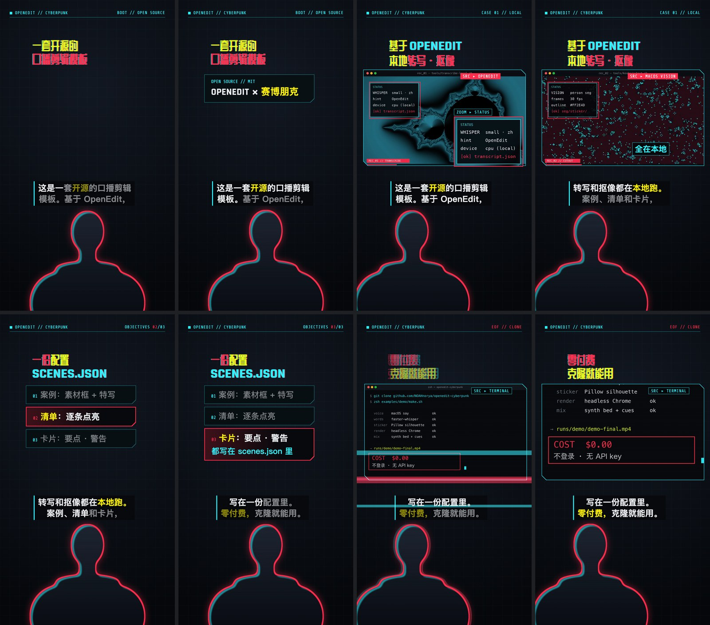

# openedit-cyberpunk

在 Claude Code 或 Codex 里，把多段口播素材剪成带赛博朋克包装的竖屏成片，再出抖音封面、标题和简介。建在 [open-edit](https://github.com/veedstudio/open-edit) 之上：转写、抠像、音效都在本机跑，不登录、不花钱。



上图是 `./setup.sh` 最后渲染的 12 秒合成样片：配音用 macOS 自带的 `say`，人像是剪影，没有真人出镜。

## 安装

```sh
git clone https://github.com/NOAHnorya/openedit-cyberpunk.git
cd openedit-cyberpunk && ./setup.sh
claude      # 或 codex：在仓库根目录打开 agent
```

新 Mac 先装 [Homebrew](https://brew.sh)（会顺带装 Xcode Command Line Tools，里面有 `git` 和 Python 3.9），再 `brew install node ffmpeg`。

`./setup.sh` 先检查 macOS、Node ≥ 20.18.1、Python（≥ 3.9 且低于 3.15）和 ffmpeg，缺什么就打印对应的 `brew install …`。然后装 open-edit 0.10.0、渲染用的 Chrome 和本地转写，最后渲染样片 `runs/demo/demo-final.mp4`（1080×1920，12 秒）。第一次运行要下载约 650 MB：whisper small 模型约 490 MB、Chrome Headless Shell 约 95 MB、Python 依赖约 70 MB。实测从 clone 到出片：带 `HTTPS_PROXY` 全程走代理约 2 分钟；只有 Python 的下载走代理、git/npm/Chrome 直连约 4.5 分钟（2026-11，Apple Silicon）。装好后重跑约 45 秒，装过的步骤会跳过。

国内网络：`git clone`、npm 和 Chrome 直连就能下。PyPI 直连实测只有 15–65 kB/s，装 Python 依赖要一个小时以上；huggingface.co 直连会被重置，模型下不了。所以第一次装最好带上代理：`HTTPS_PROXY=<代理地址> ./setup.sh`。开着 Clash 这类 macOS 系统代理时，pip 和模型下载会自动走它（Python 会读系统代理），不设也行。没有代理时，Python 依赖可以换清华镜像（见下表）；模型目前没有稳定的免代理下载办法。

过程中反复出现的 `openedit: update available … 0.10.1` 可以不理：仓库锁定 0.10.0，升级要你同意（见 `AGENTS.md`）。下载模型时的 `HF_TOKEN` 提示也不用管。

| 参数 / 环境变量 | 作用 |
|---|---|
| `--no-demo` | 只安装，不渲染样片 |
| `WHISPER_PY=<python>` | 用一个已经装了 faster-whisper 的 Python，不建 `.venv` |
| `SETUP_VENV=1` | 已装 OpenMontage 时，仍在仓库里建自己的 `.venv` |
| `HTTPS_PROXY=<代理地址>` | 下载走代理，国内下 whisper 模型基本要靠它。脚本里不写死代理，渲染样片前会去掉代理变量 |
| `PIP_INDEX_URL=https://pypi.tuna.tsinghua.edu.cn/simple` | 国内直连 PyPI 太慢时，换清华镜像装 Python 依赖（实测 22 MB/s） |
| `HF_ENDPOINT=https://hf-mirror.com` | 从镜像下载 whisper 模型。2026-11 实测接口时常报 500，大文件还会转回 HF 的 CDN，不一定下得动 |

剪辑流程写在 `.agents/skills/koubo-edit/SKILL.md`。Codex 读 `AGENTS.md`；Claude Code 经 `CLAUDE.md` 读 `AGENTS.md`。两边都会被引导去读这份 skill。想让 Claude Code 把它列进 skill 列表，再建一个软链（可选）：

```sh
mkdir -p .claude/skills && ln -s ../../.agents/skills/koubo-edit .claude/skills/koubo-edit
```

## 零付费

open-edit 有一部分功能走 VEED 或 fal 的付费服务。本仓库把这些换成了本机方案。`AGENTS.md` 里写了硬规则：agent 不登录 VEED，不设 `FAL_KEY`，碰到付费步骤会停下来，并给出本地替代方案。

| open-edit 原本的做法 | 本仓库的做法 | 在哪 |
|---|---|---|
| VEED 转写（花 VEED 额度） | 本地 faster-whisper：中文自动出简体，被拆散的英文词合回一个 | `tools/transcribe-local.sh` |
| fal 抠像（`background-removal`、`OPEN_EDIT_SPEAKER_CUTOUT`） | macOS Vision 人像分割，经 JXA 调用，不用编译 | `tools/koubo/cutout.sh` |
| fal 生成音效（`sfx` 没有音效库时的建议） | Web Audio 离线合成：4 个卡点音效，加上按成片时长合成的底乐 | `tools/koubo/webaudio/`、`templates/cyberpunk/mix.py` |
| Fabric 生成、lipsync | 不用 | — |

## 剪自己的第一条

1. 把一条视频的素材放进同一个文件夹：口播分段（按拍摄顺序，比如相机的连号文件）、录屏、截图。文件夹放哪都行，把路径告诉 agent 就可以。
2. 可选：`cp LOCAL.example.md LOCAL.md`，写上怎么称呼你、素材盘路径、代理地址和默认配乐。`LOCAL.md` 和 `local/` 都不进仓库。
3. 在仓库根目录打开 Claude Code 或 Codex，对它说：

   > 剪 `<素材文件夹>` 里的口播，套赛博朋克模板，最后出抖音封面、5 个标题和简介。

agent 按 skill 往下走，下面几处会停下来等你确认：

- 每段转写完，列出「段 / 时长 / 讲什么 / 处理」表，标出哪些是废条、哪些是重录；
- 定风格，用你的真实画面做 2–4 个方案的静帧；
- 分段：哪些段讲案例、哪些讲要点，卡片文案怎么写，素材放大哪一块；
- 封面版式和标题。

每条片子的中间文件都放在 `runs/<key>/`：粗剪 `<key>.mp4`、转写 `transcript.json`、配置 `scenes.json`、录屏和截图 `media/`、人像贴纸 `seg/sticker/`、静帧检查图 `stills.jpg`，还有成片。`runs/` 不进仓库。人像抠像默认按 4K 机位裁出人像区域，别的分辨率要设 `CROP`，写法见 `tools/koubo/cutout.sh` 开头。

## 模板能调什么

新片只改 `runs/<key>/scenes.json`，照着 `examples/demo/scenes.json` 改。字段的完整说明见 [`.agents/skills/koubo-edit/SKILL.md`](.agents/skills/koubo-edit/SKILL.md) 第 10 节。

| 字段 | 作用 |
|---|---|
| `frames` | 总帧数 = 时长 × 30 |
| `hud` | 左上角的固定标签 |
| `keyWords` | 字幕里标黄的关键词和出现时间（`词@秒`），`tools/koubo/fix_transcript.py` 会打印出来 |
| `hits` | 渐强加重音的时间点 |
| `music` | 可选，底乐文件，路径相对 run 目录；不写就自动合成 |
| `sticker` | 人像贴纸序列的目录，以及两种画面里的位置，一般不改 |
| `scenes[]` | 每段的 `t0`、`t1`、`mode`（`case` 讲案例 / `kp` 讲要点）和右上角 `hud`（`{n}` 显示当前任务号） |
| `scenes[].case` | 素材框：`items`（视频对时，或图片按 `kf` 推拉）、`boxes` / `inner_boxes` 红框、`insets` 放大特写、`tags` 标签 |
| `titles` | 标题。`fx` 默认 `ghost`（红青残影入场），揭晓时用 `glitch` |
| `cards` | 要点卡；`red` 是警告卡 |
| `tasks` | 任务清单。`on` 指定点亮的区间，`subs` 是副标题 |

文案里可以加标记：`\n` 换行，`{kw:X}` 标题里的红色关键词，`{y:X}` 卡片里的黄色关键词，`{hl:X}` 任务点亮时变黄，`{en:X}` 用英文字体，`{ec:X}` 青色英文名。

同一套模板里的其他部分：

- `examples/demo/fixes.json`：字幕纠错，以及要合并成一个词的关键词。
- `templates/cyberpunk/mix.py`：配乐和卡点音效，按 `scenes.json` 自动排；`--music <曲子>` 换成自己的曲子。
- `templates/cyberpunk/cover/build_covers.py`：配合 `examples/demo/cover.json`，出 4 种封面版式，每种都有 3:4 和 4:3。
- `templates/cyberpunk/style.css`：配色、面板和动效。

改完范例配置后，`zsh examples/demo/make.sh --stills` 只做到静帧拼图 `runs/demo/stills.jpg`，不做正式渲染；`--cover` 只出封面。

## 系统要求

- 只支持 macOS。抠像用 Vision（人像分割要 macOS 12 以上，物体抠图 `subject.js` 要 macOS 14 以上），样片配音用 `say`，桌面启动器是 AppleScript。已在 macOS 26（Apple Silicon）上验证。
- Node ≥ 20.18.1、ffmpeg 和 ffprobe：`brew install node ffmpeg`。
- Python ≥ 3.9 且低于 3.15。Homebrew 的 `python` 现在是 3.15，faster-whisper 依赖的 onnxruntime 还没有 3.15 的安装包，所以 `setup.sh` 不用它，而是挑一个 `python3.14` 到 `python3.10` 来建 `.venv`，都没有就用系统自带的 3.9。想用新一点的：`brew install python@3.13`。
- 约 1.1 GB 磁盘：Chrome Headless Shell 约 200 MB，whisper small 模型约 490 MB，`.venv` 约 230 MB，pip 缓存约 70 MB。
- 不需要 GPU，转写在 CPU 上跑（int8）。
- 已经装过 [OpenMontage](https://github.com/calesthio/OpenMontage) 的话，会直接复用它的 `.venv`，不再装一遍 faster-whisper。

可选：`extras/剪视频.applescript` 编译成桌面小程序后，双击就在这个仓库里打开 Claude Code，把视频文件拖到图标上也行。编译方法写在文件开头。

## 致谢

- [open-edit](https://github.com/veedstudio/open-edit)（VEED，Apache-2.0）：剪辑、字幕、渲染、混音用的 CLI 和 skill。本仓库通过 npm 依赖它（`@veedstudio/openedit-cli` 0.10.0），不含它的代码。
- [OpenMontage](https://github.com/calesthio/OpenMontage)（AGPL-3.0）：本地转写的思路和 faster-whisper 环境。本仓库不含它的代码，只在你已经装了它时调用它 `.venv` 里的 Python。
- [faster-whisper](https://github.com/SYSTRAN/faster-whisper)（SYSTRAN，MIT），以及 OpenAI 的 Whisper 模型（MIT）。
- 字体（SIL OFL 1.1，原文和版权声明见 `templates/cyberpunk/fonts/OFL.txt`）：
  - ZCOOL QingKe HuangYou（站酷庆科黄油体）：郑庆科，The ZCOOL QingKe HuangYou Project Authors
  - Rajdhani：Indian Type Foundry
  - Share Tech Mono：Carrois Type Design（Ralph du Carrois）
  - Chakra Petch：Cadson Demak，The Chakra Petch Project Authors

## 授权

代码用 MIT（见 [`LICENSE`](LICENSE)），字体用 SIL OFL 1.1，其余依赖的授权见 [`THIRD_PARTY.md`](THIRD_PARTY.md)。设计上的取舍写在 [`DESIGN.md`](DESIGN.md)。

## Summary in English

openedit-cyberpunk lets Claude Code or Codex cut multi-take talking-head footage into a vertical (9:16) video with a cyberpunk motion-graphics package, then make Douyin covers, titles and a description. It sits on top of [open-edit](https://github.com/veedstudio/open-edit) and swaps open-edit's paid parts for local ones: faster-whisper for transcription, macOS Vision for person cut-outs, and Web Audio for cue sounds and the music bed. No VEED login, no `FAL_KEY`, no cost.

- **Install:** `git clone https://github.com/NOAHnorya/openedit-cyberpunk.git && cd openedit-cyberpunk && ./setup.sh`, then open Claude Code or Codex in the repo. `setup.sh` checks prerequisites, installs everything and renders a 12-second synthetic demo to `runs/demo/demo-final.mp4`. `./setup.sh --help` lists the options. First run downloads about 650 MB and took 2 minutes in testing with every download behind a proxy (4.5 minutes when git, npm and Chrome went direct). In mainland China, use `HTTPS_PROXY=<proxy> ./setup.sh`: without a proxy PyPI crawls and huggingface.co is unreachable.
- **Your first cut:** put the takes, screen recordings and screenshots in one folder and tell the agent to cut them with the cyberpunk template. It follows `.agents/skills/koubo-edit/SKILL.md` and waits for your approval at the take list, the style drafts, the scene plan and the cover.
- **Template:** one `scenes.json` per video. See `examples/demo/scenes.json` and section 10 of SKILL.md.
- **Requirements:** macOS only (Vision, `say`, AppleScript); Node ≥ 20.18.1, Python 3.9–3.14 (not Homebrew's 3.15: onnxruntime has no wheels for it yet; `setup.sh` picks a suitable `python3.x`) and ffmpeg.
- **Language:** the docs, the skill and the defaults are written for Chinese videos. Transcription also accepts `--lang en`.
- **License:** code is MIT; the bundled fonts are SIL OFL 1.1; see `THIRD_PARTY.md`. Credits: open-edit (Apache-2.0), OpenMontage (AGPL-3.0, no code included), faster-whisper (MIT), and the authors of ZCOOL QingKe HuangYou, Rajdhani, Share Tech Mono and Chakra Petch.
